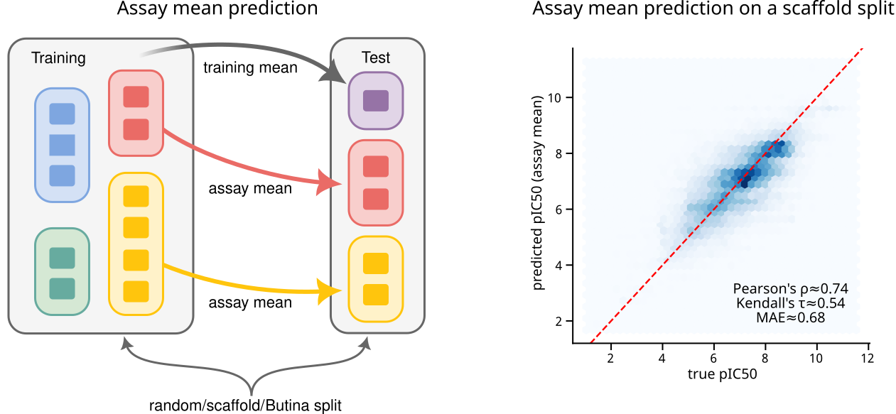
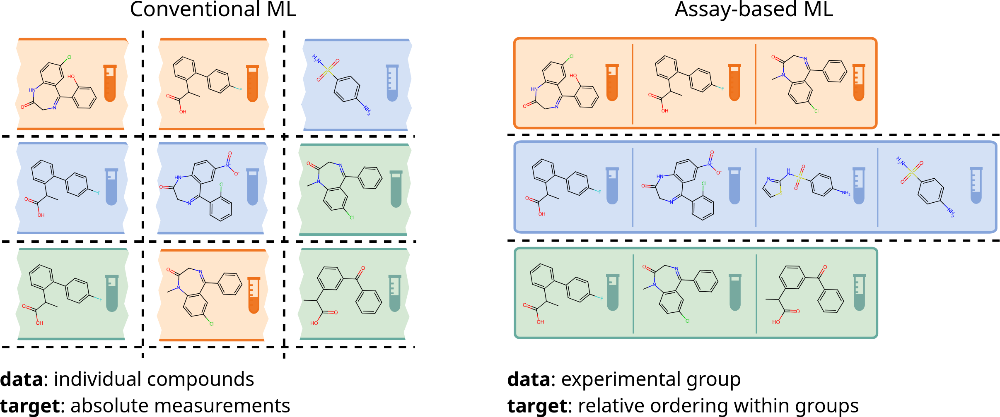

# Assay-Aware Machine Learning

This repository contains the code and data analysis pipelines for our
research on assay-aware machine learning frameworks in computational
drug discovery.

[Digital discovery article](https://doi.org/10.1039/D6DD00472E)

## Abstract

The success of machine learning (ML) in drug discovery relies on
evaluation strategies that reflect experimental practice. However,
bioactivity data in public repositories like ChEMBL is highly clustered
by assay origin. Consequently, standard random or scaffold splits
exhibit over 89% assay overlap between training and test sets, enabling
simple assay-mean baselines to achieve unexpectedly high performance
without learning molecular features.



To address this, we propose an assay-aware ML framework consisting of:

1.  **Assay-level data splitting** to prevent hidden data leakage.
2.  **Within-assay ranking evaluation metrics** that assess performance
    within individual assays to avoid over-optimistic global
    correlations driven by Simpson's paradox.
3.  **Intra-assay ranking models** trained on compound sets drawn from
    the same assay rather than arbitrary sets.



## Citation

If you use this repository or our findings in your research, please
refer to our paper:

``` bibtex
@article{backenkohler2026assayml,
    author = {Backenk\"{o}hler, Michael and Groß, Joschka  and Volkamer, Andrea},
    title = {Assay-Based Machine Learning: Rethinking Evaluation in Drug Discovery},
    journal = {Digital Discovery},
    year = {2026},
    month = {11},
    issn = {2635-098X},
    doi = {10.1039/D6DD00472E},
    url = {https://doi.org/10.1039/D6DD00472E},
    eprint = {https://pubs.rsc.org/dd/article-pdf/doi/10.1039/D6DD00472E/15052126/d6dd00472e.pdf},
}
```

## Artifacts

- [Trained models](https://zenodo.org/records/23323956)
- [Datasets and splits](https://zenodo.org/records/23323828)
